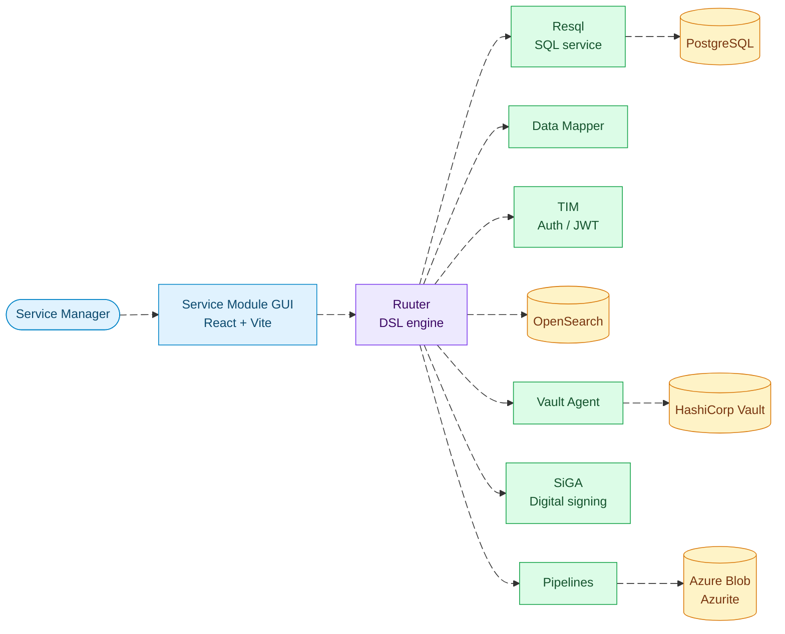

<div align="center">

# Bürokratt Service Module

**Build, test and publish Bürokratt e-services visually, without writing code.**

[](https://github.com/buerokratt/Service-Module/actions/workflows/ci-build-image.yml)
[](https://github.com/buerokratt/Service-Module/actions/workflows/run-checks.yml)
[](https://github.com/buerokratt/Service-Module/releases)


</div>

---

## Table of Contents

- [Overview](#overview)
- [Architecture](#architecture)
- [Technologies](#technologies)
- [Repository Structure](#repository-structure)
- [Prerequisites](#prerequisites)
- [Quick Start](#quick-start)
- [Configuration](#configuration)
- [Development](#development)
- [Deployment](#deployment)
- [Troubleshooting](#troubleshooting)
- [Documentation](#documentation)
- [Contributors](#contributors)

---

## Overview

Service Module is a graphical tool for **product owners**, **customer support agents** and **service managers** to create, edit and manage Bürokratt's e-services.

Key capabilities:

- 🧩 **Visual service builder**: design service flows on a drag-and-drop canvas
- 🔌 **Integrations**: call REST endpoints, X-Road services and databases from within a service
- 📚 **API Registry**: reuse registered endpoints across services
- 🧪 **Live testing**: test endpoints and whole services before publishing
- 🔗 **Service dependencies**: see how services relate to each other
- 🤖 **Ruuter DSL generation**: generate the Ruuter DSL behind each service

---

## Architecture



| Component | Role | Local port |
| --- | --- | --- |
| **GUI** | React front end | `3006` |
| **Ruuter** | Runs the DSL endpoints in [`DSL/Ruuter`](./DSL/Ruuter) | `8086` |
| **Resql** | Runs the SQL queries in [`DSL/Resql`](./DSL/Resql) | `8087` |
| **Data Mapper** | Handlebars-based data transformations | `3005` |
| **TIM** | Authentication and JWT issuing | `8085` |
| **PostgreSQL** | Services database | `5433` |
| **OpenSearch** | Search and indexing | `9200` |
| **Pipelines** | Background processing pipelines | `3010` |
| **Azurite** | Local Azure Blob Storage emulator | `10000-10002` |
| **Vault + Agent** | Secrets management | `8205` (agent) |

---

## Technologies

### Frontend

<p>
  
  
  
  
  
  
</p>

### Backend & Infrastructure

<p>
  
  
  
  
  
  
  
</p>

### Tooling

<p>
  
  
  
  
  
</p>

---

## Repository Structure

```text
Service-Module/
├── GUI/                 # React + Vite front end
├── DSL/
│   ├── Ruuter/          # Ruuter endpoint definitions (YAML)
│   ├── Resql/           # SQL queries used by Resql
│   ├── DMapper/         # Data Mapper templates
│   ├── Liquibase/       # Database migrations
│   ├── OpenSearch/      # Index mappings and deploy script
│   └── Pipelines/       # Pipeline definitions
├── vault/               # Vault + Vault Agent config
├── scripts/             # Helper scripts (Azurite init, ...)
├── docs/                # Additional documentation
├── docker-compose.yml   # Full local stack
├── migrate.sh           # Run database migrations
└── create-migration.sh  # Scaffold a new migration
```

---

## Prerequisites

| Tool | Version | Used for |
| --- | --- | --- |
| [Docker](https://docs.docker.com/get-docker/) + Compose | latest | Running the stack |
| [Node.js](https://nodejs.org/) | `22.18.0` (see [`GUI/.nvmrc`](./GUI/.nvmrc)) | GUI development |
| [Java](https://adoptium.net/) | `17` | Building SiGA |
| [pipx](https://pipx.pypa.io/) | latest | Installing SQLFluff |

---

## Quick Start

### 1. Build the dependency images

Clone each repository and build its image:

| Repository | Build command | Image tag |
| --- | --- | --- |
| [Ruuter](https://github.com/buerokratt/Ruuter) | `docker build -t ruuter .` | `ruuter` |
| [Resql](https://github.com/buerokratt/Resql) | `docker build -t resql .` | `resql` |
| [Data Mapper](https://github.com/buerokratt/DataMapper) | `docker build -t data-mapper .` | `data-mapper` |
| [TIM](https://github.com/buerokratt/TIM) | `docker build -t tim .` | `tim` |

<details>
<summary><strong>SiGA (digital signing): optional</strong></summary>

1. Clone [SiGA](https://github.com/open-eid/SiGa) and switch to Java 17.
2. Build it:
   ```bash
   ./mvnw clean install
   ./mvnw spring-boot:build-image -pl siga-webapp -DskipTests
   ```
3. Copy SiGA's `docker` folder into this repository.
4. Clone [SiGA Demo](https://github.com/open-eid/SiGa-demo-application) and build it:
   ```bash
   ./mvnw spring-boot:build-image -DskipTests
   ```
5. Generate the TLS certificates from this repository:
   ```bash
   ./docker/tls/generate-certificates.sh
   ```

</details>

### 2. Start the stack

> [!IMPORTANT]
> Make sure `REACT_APP_LOCAL=true` (the default) for local development.

```bash
docker compose $(find docker-* | sed -e 's/^/-f /') up -d
```

### 3. Open the app

Go to **<http://localhost:3006/services>**.

---

## Configuration

### Environment variables

| Variable | Where | Description | Required | Default |
| --- | --- | --- | :---: | --- |
| `REACT_APP_LOCAL` | GUI | Enables local development mode | | `true` |
| `REACT_APP_RUUTER_SERVICES_TESTING_HEADER` | GUI | `x-ruuter-testing` header value for testing services | | `voorshpellhappilo` |
| `application.apiRequestTestingKey` | Ruuter | Ruuter-side counterpart of the testing header | | `voorshpellhappilo` |
| `REACT_APP_MULTI_CHOICE_QUESTION_MAX_BUTTONS` | GUI | Max buttons in a multiple-choice question | | `4` |
| `REACT_APP_ENABLE_MULTI_DOMAIN` | GUI | Enables multi-domain support | | `FALSE` |
| `SERVICE_VAULT_AGENT` | `constants.ini` | Vault Agent proxy URL | ✅ | `http://vault-agent-service-module:8205` |
| `SERVICE_VAULT_SECRETS_PATH` | `constants.ini` | Vault KV prefix (`service-module/prod` or `service-module/test`) | ✅ | `service-module/prod` |

The full list of GUI variables is in the `gui_dev` service of [`docker-compose.yml`](./docker-compose.yml).

### Shared UI packages

The header, navigation menu and base styles come from external packages declared in [`GUI/package.json`](./GUI/package.json):

```json
"@buerokratt-ria/header": "^0.1.57",
"@buerokratt-ria/menu": "^0.2.15",
"@buerokratt-ria/styles": "^0.0.1"
```

### Vault

Backend secrets (for example the Azure Search API key) are read from **HashiCorp Vault** through a Vault Agent, not from `constants.ini`. `docker compose up -d` starts a local Vault, so Service Module can run on its own.

To add a secret locally:

```bash
docker exec service-module-vault sh -c 'VAULT_TOKEN=$(awk "/^Initial Root Token:/ {print \$4}" /vault/data/init.txt) \
  vault kv put secret/service-module/prod/azure-search api_key=<key>'
```

See the [Vault guide](./docs/vault.md) for policies, covered flows, failure modes and verification.

### OpenSearch

```bash
# Usage: ./deploy-opensearch.sh <URL> <AUTH> <IS_MOCK_ALLOWED=false>
./DSL/OpenSearch/deploy-opensearch.sh http://localhost:9200 admin:admin true
```

---

## Development

### GUI scripts

Run these from the [`GUI/`](./GUI) directory:

| Command | Description |
| --- | --- |
| `npm run dev` | Start the Vite dev server |
| `npm run build` | Type-check and build for production |
| `npm run lint` / `lint:fix` | Lint (zero warnings allowed) |
| `npm run format` / `format:fix` | Check or apply Prettier formatting |
| `npm run typecheck` | Run the TypeScript type check |
| `npm test` | Run Vitest in watch mode |
| `npm run test:run` | Run tests once |
| `npm run test:coverage` | Run tests with coverage |
| `npm run test:ui` | Open the Vitest UI |

### Database

To use the local services database:

1. In `docker-compose.yml`, set the `resql` variable `sqlms.datasources.[0].jdbcUrl` to `jdbc:postgresql://database:5432/services_db`.
2. Run the migrations:
   ```bash
   ./migrate.sh
   ```
3. Start the stack with `docker compose up -d`.

To create a new migration, run the following. It creates a timestamped file with the required headers:

```bash
./create-migration.sh name-of-migration
```

<details>
<summary><strong>Setting up the users database</strong></summary>

```bash
docker run --platform linux/amd64 --network=bykstack riaee/byk-users-db:liquibase20220615 \
  --url=jdbc:postgresql://database:5432/users_db \
  --username=byk --password=01234 \
  --changelog-file=./master.yml update
```

</details>

### SQL linting

SQL files are linted and formatted with [SQLFluff](https://sqlfluff.com/):

```bash
pipx install sqlfluff
sqlfluff lint <path>
```

IDE extensions: [VS Code](https://marketplace.visualstudio.com/items?itemName=dorzey.vscode-sqlfluff) · [JetBrains](https://plugins.jetbrains.com/plugin/20494-sqlfluff-linter-community-edition)

### CI checks

Every pull request that touches `GUI/` or `.github/` runs these checks in [GitHub Actions](./.github/workflows/run-checks.yml). Run them locally from `GUI/` before pushing:

| Check | Command |
| --- | --- |
| Formatting | `npm run format` |
| Linting | `npm run lint` |
| Unit tests | `npm run test:run` |
| Type check | `npm run typecheck` |
| Docker build | `docker image build .` (non-draft PRs only) |

---

## Deployment

Production deployments run on **Kubernetes** using the manifests in [buerokratt/NoOps](https://github.com/buerokratt/NoOps/tree/dev/Kubernetes/Modules/Service-Module).

> [!NOTE]
> The production navigation menu is configured through `REACT_APP_MENU_JSON` in the [GUI deployment template](https://github.com/buerokratt/NoOps/blob/dev/Kubernetes/Modules/Service-Module/templates/deployment-byk-services-gui.yaml). A reference value is in the commented-out production block of the `gui_dev` service in [`docker-compose.yml`](./docker-compose.yml).

---

## Troubleshooting

<details>
<summary><strong>Logging in locally through TIM</strong></summary>

Locally, create the auth cookie by hand:

1. Call the login endpoint:
   ```bash
   curl -X POST -H "Content-Type: application/json" \
     -d '{"login": "EE30303039914", "password": "OK"}' \
     http://localhost:8086/services/auth/login
   ```
2. In the browser, create a cookie named `customJwtCookie` with the returned value.

</details>

<details>
<summary><strong>Running alongside Buerokratt-Chatbot's shared Vault</strong></summary>

Stop the local Vault first so the two don't conflict:

```bash
docker compose stop service-module-vault vault-agent-service-module
```

</details>

---

## Documentation

| Document | Description |
| --- | --- |
| [Vault](./docs/vault.md) | Secrets management, policies and failure modes |
| [Intent Classification](./docs/INTENT_CLASSIFICATION.MD) | Intent classification flow |
| [Endpoints](./docs/endpoints.md) | Service API endpoints |
| [OpenSearch](./DSL/OpenSearch/README.md) | Index setup and mappings |
| [Changelog](./CHANGELOG.md) | Version history |
| [Release Notes](./RELEASE_NOTES.md) | Release highlights |

---

## Contributors

<a href="https://github.com/buerokratt/Service-Module/graphs/contributors">
  
</a>
